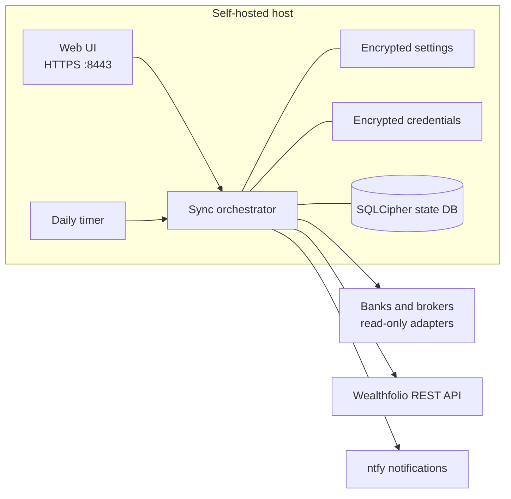

# Architecture

This document explains the current architecture of Wealthfolio Companion and the reasons behind its main design decisions. For installation and day-to-day operation, see the [README](README.md). Contributor rules, invariants, broker-adapter guidance, and release procedures are documented in [CLAUDE.md](CLAUDE.md).

## Overview

Wealthfolio Companion is a self-hosted, read-only collector for broker and bank data. It normalizes transactions and holdings, then writes supported activities to Wealthfolio through Wealthfolio's REST API. It does not place trades, move money, or change broker settings.

The application can run as a Proxmox LXC service or as a Docker/Podman container. It has three main runtime responsibilities:

- **Web UI** (wealthfolio-companion serve): setup, broker authentication, manual runs, reconciliation, settings, and security controls.
- **Sync runner** (wealthfolio-companion run): processes enabled brokers in sequence, usually on the daily schedule.
- **Optional updater** (companion-autoupdate): checks for a newer release and installs it only when automatic updates are enabled.

The web UI and sync runner share the same code and data directory. A file lock prevents concurrent sync runs, including when a user starts one while the scheduled run is active. Services run as the dedicated companion user with systemd hardening and write access restricted to the data directory. The service key is supplied by systemd as a credential; it is not stored alongside the encrypted application data.



## Module boundaries

The code follows a one-way dependency flow:

1. **Adapters** communicate with a bank or broker and return broker-neutral objects from model.py. They do not know about Wealthfolio's data model.
2. **Mapping** converts a normalized transaction into one or more Wealthfolio activities. Mapping rules depend on the normalized transaction kind, not on a specific broker.
3. **Sync orchestration** coordinates fetching, duplicate detection, mapping, writing, reconciliation, and notifications.

This separation means that adding a broker should normally require an adapter and its tests, not changes to the shared mapping rules.

Important modules include:

| Module | Responsibility |
|---|---|
| sync.py | Coordinates sync runs and the per-broker workflow |
| adapters/ | Broker-specific authentication, fetching, and normalization |
| model.py | Broker-neutral transactions, positions, and balances |
| mapping.py | Converts normalized transactions into Wealthfolio activities |
| dedup.py | Matches transactions already imported into Wealthfolio |
| wealthfolio.py | Wealthfolio REST API client |
| state.py | Persistent sync state and run history |
| vault.py / config.py | Encrypted credentials and settings |
| reconcile.py / coverage.py | Compares broker history and Wealthfolio activities |
| notify.py | Sends notifications through ntfy |
| lookthrough.py / xray.py | ETF holdings, exposure, overlap, and concentration analysis |
| costs.py / fire.py | Investment-cost estimates and the FIRE calculator |
| web/routes/ | UI endpoints, grouped by functional area |

## Sync lifecycle

A run acquires the shared lock, marks abandoned runs as aborted, and processes configured brokers one at a time. Each broker is isolated in its own error boundary: one broker failing does not prevent the others from running. The run records its status and sends a notification where appropriate.

The per-broker workflow broadly follows these steps:

1. Authenticate and fetch transactions, balances, statements, and positions supported by the adapter.
2. Normalize the response into broker-neutral model objects.
3. Identify already-synced transactions and transactions that were imported manually.
4. Repair supported cash-activity shapes where necessary before reconciliation.
5. Map new transactions to Wealthfolio activities and submit them through the REST API.
6. Reconcile the broker's history and holdings with Wealthfolio, when the adapter provides enough information.
7. Save state and report success, authentication requirements, or errors.

The sequence is significant. For example, cash-activity repairs happen before reconciliation, and the securities side of a trade is processed after the cash-side booking so that the two can be matched. A failed multi-activity transaction remains incomplete and is retried on a later run.

### Authentication modes

In **Automatic** mode, supported sessions are retained so scheduled runs can proceed. In **Secure** mode, scheduled runs only notify the user; the user starts a run from the UI and completes required logins. The service then clears broker sessions after each broker run, including failed runs, while retaining the safety state needed to avoid repeated rejected PIN attempts.

Broker adapters may require a TAN, one-time code, device-code approval, or confirmation in a banking app. These challenges are surfaced in the UI for manual runs or sent as ntfy notifications for scheduled runs that cannot continue without the user.

## Duplicate prevention and booking model

A transaction may already exist because the companion synced it earlier, a previous run stopped partway through a multi-activity booking, or the user imported a CSV/PDF statement. Duplicate prevention therefore uses multiple layers:

1. The persistent sync state records transactions already handled.
2. Wealthfolio's duplicate-activity response and the sync reference in activity comments detect activities created before an interrupted run.
3. An existing-activity index matches compatible manually imported activities by account, type, currency, time, quantity, and amount.

The sync marks a transaction complete only after all activities belonging to it exist. If the sync state is lost, the Wealthfolio-side references can recover already-created activities. Reconciliation also detects activities that disappeared from Wealthfolio. It reports them for user review rather than recreating them automatically, because a deletion may have been intentional.

Each broker uses a **cash account** and a **securities account** in Wealthfolio. Some FinTS banks can also use a savings account. Deposits, withdrawals, interest, fees, and taxes are represented as cash-account activities. Transfers between a user's own accounts are represented as paired transfer activities. A securities trade can involve several activities, and the mapping rules preserve the relationship between the cash and securities sides. Cash activities must not carry a security asset: an asset on a transfer can make Wealthfolio interpret it as a securities transfer rather than a cash movement.

Unknown transactions are retained and shown in the UI for classification. Once the user classifies one, the next run books it under the same stable transaction identity.

## Adapters

All adapters inherit from the shared broker-adapter interface and are read-only. They normalize broker data into common transaction, position, and cash-balance structures. Authentication and session handling are adapter-specific, while booking, deduplication, and reconciliation remain shared.

The supported integrations include Trade Republic, Scalable Capital, comdirect, DKB, Deutsche Bank, N26, other FinTS institutions, and PSD2 banks through Enable Banking. Some integrations provide holdings directly; others provide transactions or uploaded statements only. The UI and reconciliation logic account for these differences.

Adapters have contract tests based on recorded responses so their parsing and normalization can be tested without contacting a real financial institution. Tests use fake broker clients and do not perform real trading or money movement.

## Reconciliation and portfolio features

When supported data is available, the service compares broker cash balances and positions with Wealthfolio holdings. It can flag missing activities, unmatched transfers, non-zero cash on the securities account, and differences in positions. The user decides whether to rebook or ignore a missing activity; the service does not silently recreate deleted records.

Optional services can write additional data to Wealthfolio, including ISINs, logos, spending summaries, and country/sector taxonomies. ETF look-through fetches holdings lists from supported issuers and can calculate concentration risks, overlap, and estimated costs. The X-Ray add-on reads holdings lists stored by the companion in Wealthfolio; the add-on itself does not need to contact external providers.

Optional features are separately enabled in the UI. They do not alter the underlying broker transaction results.

## Data protection

Credentials, sessions, configuration, notification settings, and sync state are stored separately and encrypted. The service key is kept outside the application data directory and supplied at runtime by the host. The UI uses HTTPS with a certificate issued by the installation's own CA, a separate login, CSRF protection, secure cookies, and throttling for failed login attempts.

An optional master passphrase strengthens protection against someone who obtains both the application data and its service key. The service must be unlocked after restart when this option is enabled. Losing the passphrase means the encrypted data cannot be recovered.

Sensitive values such as credentials, tokens, IBANs, and account numbers are redacted from logs, notifications, and UI errors. Security events are retained for a limited period without storing passwords or credential values. See [SECURITY.md](SECURITY.md) for reporting vulnerabilities and [docs/OPERATIONS.md](docs/OPERATIONS.md) for operational security and backup procedures.

## Web application

The web app is built with FastAPI and groups endpoints by functional area: setup and authentication, services, brokers, settings, reconciliation, securities, notifications, look-through, and security. Shared application state is held in an application context that provides access to the vault, persistent state, sync runner, UI configuration, and background jobs.

The UI supports German and English. Translation keys are maintained in the internationalization module and checked by tests so that user-facing UI strings have English equivalents. Logs, broker-provided error text, and certain external messages remain in their original form.

## Errors and resilience

Errors are isolated by broker. Authentication challenges are reported as needs_auth; adapter or Wealthfolio failures are reported as errors and logged with sensitive details redacted. A failed individual activity leaves the transaction incomplete so a later run can retry it. If holdings cannot be read, the transaction sync can still succeed while reconciliation is skipped.

Rate limits (HTTP 429/503) follow one rule, `ratelimit.py`: idempotent reads (N26, comdirect, Enable Banking `GET`) go through `with_backoff` - up to three more tries after `Retry-After` or 2/5/15 s (each wait at most 60 s, with jitter); a login, token, password or refresh grant, TAN or challenge request is never repeated. A broker still limited after that raises `RateLimited` (Trade Republic when pytr reports `TOO_MANY_REQUESTS`, Scalable after its own longer waits outside the detail queries): the run ends with status `limited`, nothing of it is marked synced, the next try is stored in `meta` `rate-limit:<broker>` and scheduled runs skip the broker until then (a fetch started in the UI still tries), ntfy tells it once, and the broker card shows it in yellow. Scalable's detail queries keep their own handling (`incomplete`); the look-through and logo passes stop their requests on a 429 for the pass.

Operations that replace encrypted files use recoverable, staged transitions so an interrupted key or passphrase change can recover the previous or new state rather than leave a mixed set of files. Updates back up encrypted data first, verify downloaded release files against checksums, and restore the previous running version if installation fails.

## Installation, releases, and tests

The Proxmox installer creates an LXC and installs the latest GitHub release. Docker and Podman use a published image running as an unprivileged user, with the service key mounted as a secret. Runtime dependencies are pinned and hash-checked. Release artifacts include a source archive and SHA256SUMS with SLSA build provenance, which install and update verify offline (`provenance.py` in a hash-locked venv from `requirements-verify.txt`: on a new install fetched from `main`, the trust anchor; afterwards the installed release's own) before unpacking; `deploy/companion-update` stages each release in `releases/<version>-<id>`, switches the `current` symlink, health-checks and rolls back release and data on failure; CI validates the code and packaging before publication.

Run the automated test suite with:

```bash
pytest -q
```

Tests run without a network connection or real broker credentials. They cover mapping, sync lifecycle, adapter behavior, duplicate detection, Wealthfolio API interactions, web security, encryption, packaging, release verification, and shared deduplication contract cases.

For installation, update, backup, and restore instructions, see [Operations](docs/OPERATIONS.md).