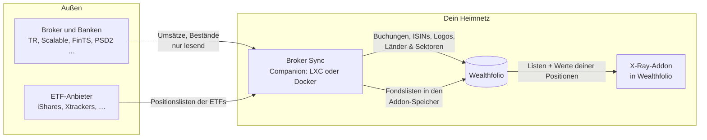

# Wealthfolio Broker Sync

Holt deine Buchungen automatisch bei deinen Brokern und Banken ab und trägt sie ohne Duplikate in dein **selbst gehostetes [Wealthfolio](https://wealthfolio.app)** ein. Dazu ergänzt er, was Wealthfolio allein nicht kann: Länder und Sektoren deiner ETFs, ISINs, Logos und eine Durchschau durch deine ETFs (X-Ray). Einmal einrichten, danach läuft alles jeden Morgen von selbst.

- **Trade Republic, Scalable Capital, comdirect, DKB, Deutsche Bank, N26**, jede andere Bank mit **FinTS** (Sparkasse, Volksbank …) und jede Bank mit **PSD2**-Schnittstelle – [Einzelheiten je Bank](docs/BANKEN.md)
- **Keine Duplikate:** Was schon in Wealthfolio steht, auch aus einem CSV- oder PDF-Import, wird erkannt
- **Nur lesender Zugriff** auf die Broker; **alles verschlüsselt** (AES-256), der Schlüssel liegt nicht bei den Daten
- **Alles in der Weboberfläche**, mit Benachrichtigung aufs Handy (ntfy), wenn eine TAN fällig ist

## So arbeiten die Teile zusammen



Der **Broker Sync** ist der Companion zu Wealthfolio: Er spricht mit Brokern, Banken und ETF-Anbietern und schreibt nur über Wealthfolios eigene Schnittstelle. Jeder Dienst, der etwas in Wealthfolio schreibt, lässt sich auf der Startseite *Dienste* einzeln ein- und ausschalten. Das **[X-Ray-Addon](https://github.com/waldonso2/wealthfolio-companion-addon-xray)** zeigt die Durchschau durch deine ETFs direkt in Wealthfolio. Es geht selbst nicht ins Netz und liest nur, was der Companion dort ablegt.

## Was du brauchst

- **Wealthfolio** als selbst gehostete Version (für das X-Ray-Addon ab 3.11) und das Wealthfolio-Passwort
- in Wealthfolio je Broker **zwei Konten**: ein Verrechnungskonto (Cash) und ein Depotkonto ([warum](docs/FUNKTIONEN.md#wie-gebucht-wird))
- einen **Proxmox-Server** (VE 8 oder 9) **oder** einen Rechner mit **Docker**
- optional die App **ntfy** auf dem Handy ([Android](https://play.google.com/store/apps/details?id=io.heckel.ntfy), [iOS](https://apps.apple.com/app/ntfy/id1625396347))

## Installation

### Mit Proxmox (empfohlen)

In der Proxmox-Oberfläche den Server wählen, *>_ Shell* öffnen und einfügen:

```bash
bash -c "$(curl -fsSL https://raw.githubusercontent.com/waldonso2/wealthfolio-broker-sync-service/main/ct/wealthfolio-broker-sync.sh)"
```

*Default Settings* passen (1 CPU, 512 MB RAM, 2 GB Disk, Debian 13). Am Ende stehen die Adresse der Oberfläche (z. B. `https://192.168.1.51:8443`) und der Einrichtungscode. **Aktualisieren:** in der Konsole des Containers `update`, oder automatisch über die Seite *Updates*. Jedes Update prüft jede Datei gegen die Prüfsummen des Releases.

### Mit Docker

```bash
curl -fsSLO https://raw.githubusercontent.com/waldonso2/wealthfolio-broker-sync-service/main/deploy/docker-compose.example.yml
openssl rand -base64 32 > brokersync.key && chmod 600 brokersync.key   # den Schlüssel gut aufbewahren
docker compose -f docker-compose.example.yml up -d
docker compose -f docker-compose.example.yml logs brokersync            # zeigt den Einrichtungscode
```

Die Datei startet den Companion zusammen mit Wealthfolio; für Wealthfolio setzt du vorher `WF_SECRET_KEY` und `WF_AUTH_PASSWORD_HASH` in einer `.env` daneben (wie in Wealthfolios eigener Anleitung). Hast du Wealthfolio schon, lass dessen Teil (und `depends_on`) weg und trag im Companion seine Adresse ein. Die Oberfläche liegt dann unter `https://<Rechner>:8443`. Der Container läuft ohne Root-Rechte und mit schreibgeschütztem Dateisystem; der Schlüssel kommt als Secret. Ohne `brokersync.key` sind die Daten verloren, mit ihm und dem Volume lassen sie sich öffnen – dagegen schützt die Master-Passphrase. **Aktualisieren:** `docker compose pull && docker compose up -d`. Hinter einem Reverse Proxy: `BROKERSYNC_TLS=off` und `BROKERSYNC_TRUST_PROXY` (siehe die Kommentare in der Datei).

## Einrichten

1. **Passwort** festlegen – mit dem Einrichtungscode, der nur in der Konsole bzw. im Log steht.
2. **Zertifikat:** Beim ersten Öffnen die Warnung des Browsers bestätigen. Auf der Seite *Sicherheit* das CA-Zertifikat laden und einmal importieren; danach gilt die Verbindung als sicher.
3. **Wealthfolio verbinden:** Adresse und Passwort. *Nur testen* prüft die Verbindung, ohne zu speichern.
4. **Broker einrichten:** Zugangsdaten, die beiden Konten und das Startdatum. Danach meldet sich der Dienst an und fragt nach TAN oder App-Freigabe.
5. **Dienste einschalten:** Auf der Startseite *Dienste* den **Broker-Sync** und, was du sonst willst, einschalten. Neu ist alles aus; fehlt etwas, öffnen sich die nötigen Einstellungen.
6. **Benachrichtigungen:** In der ntfy-App das Thema von der Seite *Benachrichtigungen* abonnieren.
7. **Erster Abruf:** Seite *Broker* → **Alle abrufen**. Danach läuft der Abruf jeden Morgen zwischen 6:00 und 6:45 Uhr.

<picture><source media="(prefers-color-scheme: dark)" srcset="docs/screenshots/07-nach-dem-abruf-dunkel.png"></picture>

## Im Alltag

| Was passiert | Was du tust |
|---|---|
| Push „Anmeldung nötig“ | Antippen, TAN eingeben – fertig |
| Push „Abruf fehlgeschlagen“ | Seite *Broker* öffnen, dort steht der Grund |
| „unbekannte Buchungen“ | Unter *Broker → Unbekannt* sagen, was es ist; der nächste Abruf bucht es |
| Abweichung zu Wealthfolio | *Broker → Prüfung*: fehlende Buchungen wieder anlegen oder ignorieren |
| Was steckt in meinen ETFs? | Seite *X-Ray*, oder in Wealthfolio mit dem X-Ray-Addon |
| Passwort vergessen | Konsole: `brokersync-reset-password` (Docker: `docker exec -it brokersync brokersync reset-ui-password`) |

Alles Weitere – Abgleich, X-Ray, Kosten und FIRE, Buchungsmodell, Proxy, Logs, Kennzahlen – steht in [docs/FUNKTIONEN.md](docs/FUNKTIONEN.md). Updates, Sicherheit, Sicherung und Technik stehen in [docs/BETRIEB.md](docs/BETRIEB.md).

## Sicherheit in Kürze

- Zugangsdaten, Einstellungen und die Sync-Datenbank sind verschlüsselt (AES-256-GCM bzw. SQLCipher). Der Schlüssel des Dienstes liegt außerhalb der Daten: in Proxmox mit `systemd-creds`, in Docker als Secret.
- **Master-Passphrase (wahlweise):** Mit ihr öffnet auch eine Kopie samt Schlüssel nichts. Ohne die Passphrase sind die Daten verloren.
- Nur lesender Zugriff auf die Broker; Schutz vor Sperren (keine zweite falsche PIN oder TAN); die Oberfläche nur per HTTPS, mit eigenem Login und gebremsten Fehlversuchen.
- Die Seite *Sicherheit* zeigt jederzeit, was wie geschützt ist. Lücken bitte privat melden: [SECURITY.md](SECURITY.md).

## Entstehung

Dieses Projekt ist komplett am Handy entstanden, im Gespräch mit Claude: Code, Tests, Reviews und Releases.

## Danke

- [pytr](https://github.com/pytr-org/pytr) (MIT) für Trade Republic
- [python-fints](https://github.com/raphaelm/python-fints) (LGPL) für FinTS
- [Scalable CLI](https://github.com/ScalableCapital/scalable-cli) (Apache-2.0) von Scalable Capital; die Zuordnung der Buchungsarten folgt dem [Scalable Capital Transactions Exporter](https://github.com/matthesvoss/Scalable-Capital-Transactions-Exporter) (MIT)

## Lizenz

MIT
