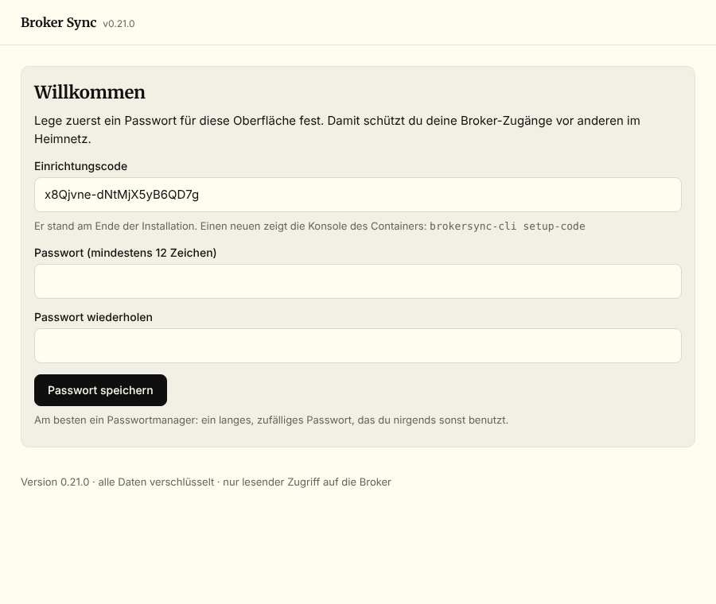
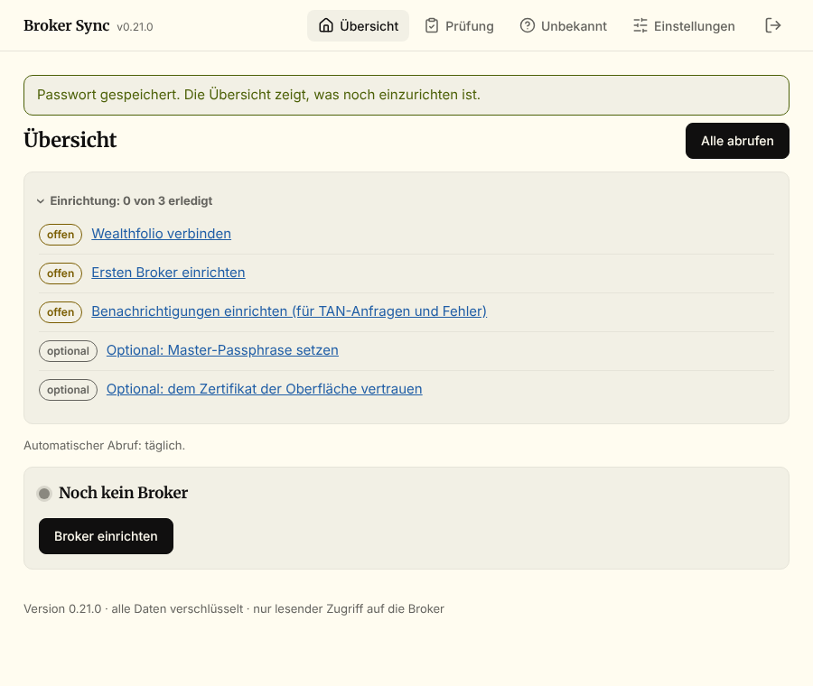
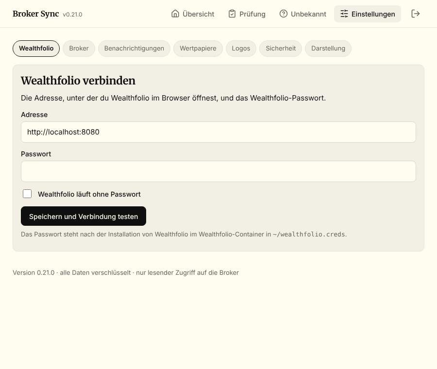
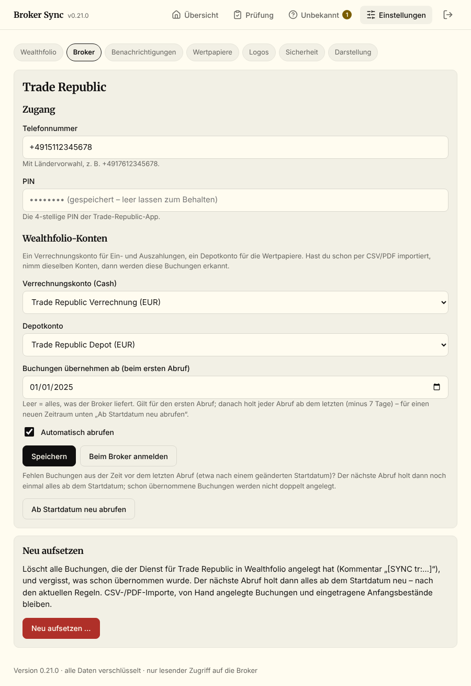
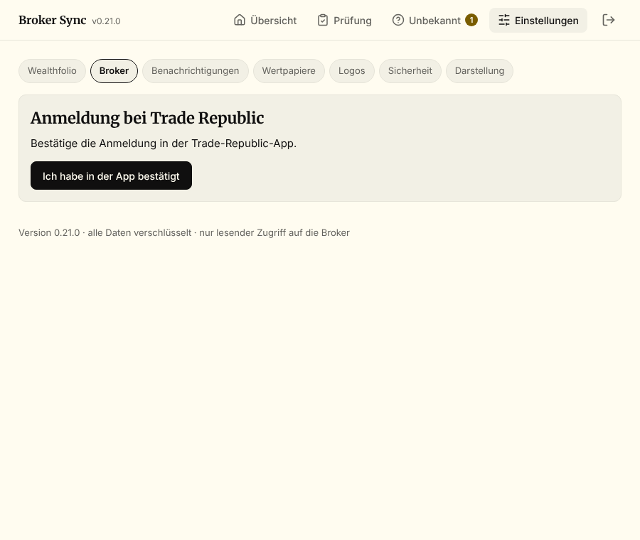
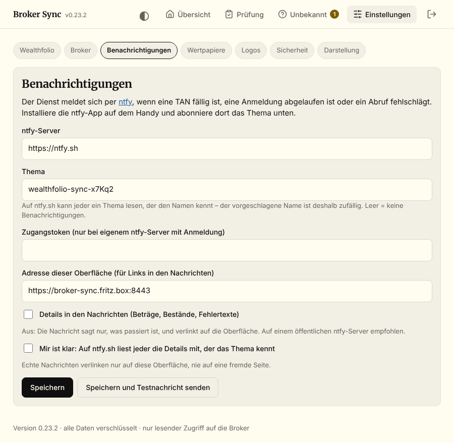
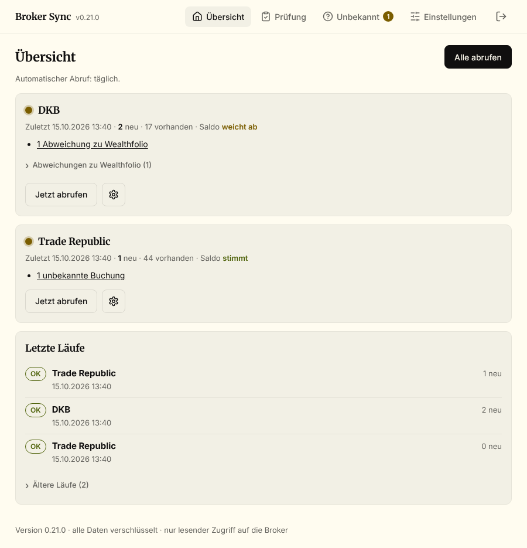
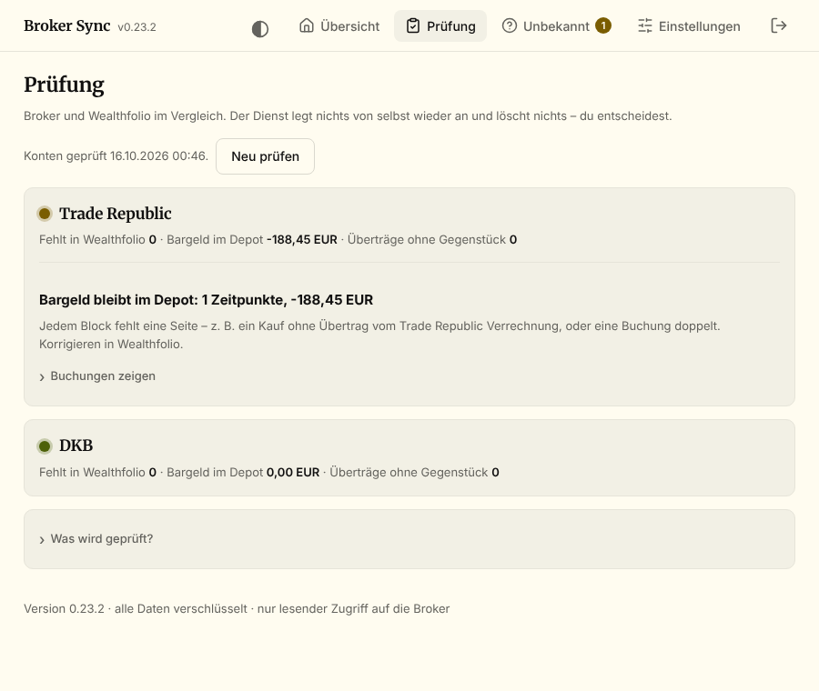
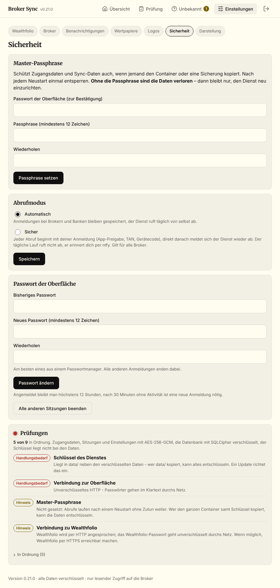

# Wealthfolio Broker Sync

Holt deine Buchungen automatisch bei deinen Brokern ab und trägt sie ohne Duplikate in dein **selbst gehostetes [Wealthfolio](https://wealthfolio.app)** ein. Einmal einrichten, danach läuft der Abruf täglich von selbst.

- **Installation mit einer Zeile** in der Proxmox-Shell, wie bei den [Community-Skripten](https://community-scripts.org): eigener Container, fertig eingerichtet
- **Alles in der Weboberfläche:** keine Konfigurationsdateien, keine Kommandozeile
- **Alles verschlüsselt:** Zugangsdaten, Einstellungen und Sync-Daten (AES-256), der Schlüssel liegt nicht bei den Daten; Oberfläche nur per HTTPS; wahlweise mit Master-Passphrase. **Nur lesender Zugriff** auf die Broker
- **Benachrichtigung aufs Handy** (ntfy), wenn eine TAN fällig ist oder etwas nicht klappt
- **Keine Duplikate:** Was schon in Wealthfolio steht – auch aus einem früheren CSV- oder PDF-Import –, erkennt der Dienst und legt es nicht noch einmal an
- **Prüft sich selbst:** Nach jedem Abruf vergleicht er Konto und Depot mit dem Broker und zeigt, wo etwas fehlt oder nicht aufgeht

> **Stand:** **Trade Republic**, **DKB** (Girokonto per FinTS), **Scalable Capital** (über Scalables offizielles CLI), **comdirect** (Girokonto und Depot über die offizielle REST-API) **Deutsche Bank** (Girokonto und maxblue-Depotbestand per FinTS; neu, noch nicht lange im Einsatz) und **jede andere Bank mit FinTS** – z. B. Sparkasse, Volks- und Raiffeisenbank (Girokonto; neu, je Bank noch ungeprüft).

## Was du brauchst

- einen **Proxmox-Server** (VE 8 oder 9)
- **Wealthfolio** als selbst gehostete Version (z. B. über das Community-Skript „Wealthfolio“) und das Wealthfolio-Passwort
- in Wealthfolio je Broker **zwei Konten**: ein Verrechnungskonto (Cash) und ein Depotkonto (siehe [Wie gebucht wird](#wie-gebucht-wird)).
- optional die App **ntfy** auf dem Handy ([Android](https://play.google.com/store/apps/details?id=io.heckel.ntfy), [iOS](https://apps.apple.com/app/ntfy/id1625396347))

## Installation

1. **Proxmox-Shell öffnen.** In der Proxmox-Oberfläche links deinen Server (Knoten) wählen, dann oben rechts *>_ Shell*.
2. **Diese Zeile einfügen und Enter drücken:**

   ```bash
   bash -c "$(curl -fsSL https://raw.githubusercontent.com/waldonso2/wealthfolio-broker-sync-service/main/ct/wealthfolio-broker-sync.sh)"
   ```

   Es erscheint der bekannte Assistent der Community-Skripte. *Default Settings* wählen – die Standardwerte passen: 1 CPU, 512 MB RAM, 2 GB Disk, Debian 13, unprivilegiert. Der Kopf zeigt dabei „Scripts fork: waldonso2/wealthfolio-broker-sync-service“; das ist richtig, der Dienst kommt aus diesem Repository und nicht aus der offiziellen Sammlung.
3. **Öffnen.** Am Ende zeigt die Installation die Adresse der Weboberfläche an, z. B. `https://192.168.1.51:8443`. Diese im Browser öffnen. Das Zertifikat stellt der Container mit einer eigenen Zertifizierungsstelle (CA) aus. Beim ersten Mal die Warnung des Browsers bestätigen, dann auf der Seite *Sicherheit* das CA-Zertifikat herunterladen und einmal importieren (Anleitung für Windows, macOS, Firefox, iPhone und Android steht dort). Danach zeigt der Browser die Verbindung als sicher, auch nach jeder Erneuerung. Die CA kann nur diesen Container bestätigen – seinen Namen und seine Adressen –, keinen Router und kein anderes Gerät; bekommt der Container eine neue Adresse, entsteht eine neue CA, die du einmal neu importierst. Das Zertifikat erneuert sich täglich von selbst. Weitere Namen oder Adressen (etwa eine Tailscale-Adresse) gehören, eine pro Zeile, in `/etc/wealthfolio-broker-sync/tls/extra-names`. Aufrufe über `http://…:8090` leiten dorthin weiter.

**Aktualisieren:** In Proxmox die Konsole des Containers öffnen und `update` eingeben. Einstellungen und Zugangsdaten bleiben erhalten; vorher wird eine Sicherung der verschlüsselten Daten unter `/opt/wealthfolio-broker-sync/backup-*.tar.gz` angelegt (die letzten drei bleiben). Installation und Update prüfen jede heruntergeladene Datei gegen die Prüfsummen (`SHA256SUMS`), die der Release-Workflow mit dem Release veröffentlicht. Passt eine nicht oder ist eine zu viel, brechen sie ab, und die bisherige Version läuft weiter. Eine bestimmte Version, auch eine ältere: `VERSION=<Version> update`. Ohne `VERSION` geht das Update nie auf eine ältere Version zurück.

**Neue Version:** Einmal am Tag fragt der Dienst nach einem Abruf bei GitHub, welches Release das neueste ist (gelesen wird nur die Weiterleitung von `releases/latest`, mitgeschickt wird nichts). Ist es neuer als das installierte, steht das auf der Übersicht, und ntfy meldet es einmal. Installiert wird nichts von selbst – das bleibt `update`. Abschalten: `Environment=BROKERSYNC_UPDATE_CHECK=0` per `systemctl edit wealthfolio-broker-sync-run`.

> **PVE Scripts Local:** Der Dienst erscheint dort (noch) nicht. PVE Scripts Local zeigt nur Skripte aus der offiziellen Sammlung von community-scripts.org an; ein unter *Repositories* eingetragenes eigenes Repo bringt keine neuen Skripte in den Katalog. Die Aufnahme in die offizielle Sammlung ist geplant, sobald echte Broker angebunden sind.

## Einrichtung im Browser

### 1. Passwort für die Oberfläche festlegen

Beim ersten Öffnen legst du ein Passwort fest. Es schützt deine Broker-Zugänge vor anderen im Heimnetz. Dazu gehört der **Einrichtungscode**, den die Installation am Ende anzeigt (der angezeigte Link füllt ihn schon aus). Er gilt 24 Stunden und nur einmal; so kann niemand sonst im Netz das Passwort vor dir festlegen. Einen neuen Code zeigt die Konsole des Containers: `brokersync-cli setup-code`.



Danach zeigt die Übersicht eine Checkliste mit dem, was noch zu tun ist: Wealthfolio verbinden, den ersten Broker einrichten, Benachrichtigungen, und wahlweise Master-Passphrase und Zertifikat. Ist alles erledigt, lässt sie sich ausblenden.



### 2. Wealthfolio verbinden

Die Adresse, unter der du Wealthfolio öffnest, und das Wealthfolio-Passwort. Nach dem Speichern wird die Verbindung sofort getestet; *Nur testen* prüft sie, ohne etwas zu speichern. Am besten per `https://`: Mit `http://` gehen Passwort und Buchungen unverschlüsselt durchs Netz. Hat dein Wealthfolio ein selbst ausgestelltes Zertifikat, zeigt die Seite dessen Fingerabdruck; stimmt er mit dem überein, den dein Browser bei Wealthfolio zeigt, vertraut der Dienst nach dem Speichern genau diesem Zertifikat.



### 3. Broker einrichten

Zugangsdaten eintragen und die beiden Wealthfolio-Konten wählen. Mit *Buchungen übernehmen ab* bestimmst du, wie weit der erste Abruf zurückgeht; danach holt jeder Abruf ab dem letzten (minus 7 Tage). Soll später doch ein früherer Zeitraum dazukommen, Startdatum ändern und *Ab Startdatum neu abrufen* klicken – schon übernommene Buchungen werden nicht doppelt angelegt. Scalable liest bei jedem Abruf alles ab dem Startdatum, dort ist der Knopf nicht nötig. *Automatisch abrufen* anhaken.



### 4. Beim Broker anmelden

Nach dem Speichern meldet sich der Dienst beim Broker an. Will der Broker eine TAN oder eine Bestätigung in seiner App, fragt die Seite danach.



### 5. Benachrichtigungen

ntfy-App öffnen, *Thema abonnieren* und den Themennamen von dieser Seite eintragen. Mit *Testnachricht senden* prüfen.



### 6. Erster Abruf

In der Übersicht **Alle abrufen** klicken (oder bei einem Broker **Jetzt abrufen**). Danach siehst du je Broker, was neu angelegt wurde und was schon in Wealthfolio war. Broker mit ausgeschaltetem *Automatisch abrufen* überspringt der tägliche Lauf und „Alle abrufen“ – sie rufst du mit ihrem eigenen Button ab.

<picture><source media="(prefers-color-scheme: dark)" srcset="docs/screenshots/07-nach-dem-abruf-dunkel.png"></picture>

Ab jetzt läuft der Abruf jeden Morgen zwischen 6:00 und 6:45 Uhr.

## DKB

Der Dienst liest dein **DKB-Girokonto** per FinTS (HBCI), dieselbe Schnittstelle, die Finanzprogramme wie Hibiscus oder MoneyMoney nutzen. Er liest nur; Überweisungen kann er nicht auslösen.

**Einrichten** unter *Broker → DKB*:

- **Anmeldename und PIN:** dieselben wie im DKB-Banking.
- **IBAN des Girokontos:** nur nötig, wenn du bei der DKB mehrere Konten hast.
- **Konten:** ein DKB-Verrechnungskonto und ein DKB-Depotkonto in Wealthfolio, wahlweise dazu ein **Tagesgeld-Konto** (siehe unten).

**Freigabe in der DKB-App:** Bei der ersten Anmeldung und danach in Abständen (nach den PSD2-Regeln meist alle 90 Tage) will die DKB eine Bestätigung in der DKB-App. In der Oberfläche bestätigst du in der App und klickst dann *Ich habe in der App bestätigt*. Läuft gerade der tägliche Abruf, schickt der Dienst eine ntfy-Nachricht und wartet drei Minuten auf deine Freigabe.

**Was gebucht wird:**

| Auf dem Girokonto | In Wealthfolio (DKB-Verrechnungskonto) |
|---|---|
| Gutschrift, Gehalt, eingehende Überweisung | Einzahlung (DEPOSIT) – eingehendes Geld ist immer eine Einzahlung |
| Kartenzahlung, Lastschrift, ausgehende Überweisung | Auszahlung (WITHDRAWAL), also eine Ausgabe |
| Ausgehende Überweisung auf ein eigenes Konto | Übertrag (TRANSFER_OUT, mit Gegenbuchung auf dem gewählten Konto), wenn ein Übertragsmuster passt (siehe *Im Alltag*) |
| Habenzinsen / Kontoführungsentgelt beim Rechnungsabschluss | Zinsen (INTEREST) / Gebühr (FEE) |
| Wertpapierabrechnung, Ertragsgutschrift, Dividende | **nichts** – siehe unten |

**Wertpapiere:** Das DKB-Depot liefert FinTS nicht als Umsätze. Käufe, Verkäufe und Ausschüttungen kommen deshalb über einen Import der Wertpapierabrechnungen (PDF) in Wealthfolio, der nach demselben Zwei-Konten-Modell bucht (Übertrag vom bzw. zum Verrechnungskonto). Damit nichts doppelt zählt, bucht der Dienst die zugehörigen Girokonto-Umsätze nicht noch einmal. Er prüft nur, ob der Übertrag dazu schon da ist (gleicher Betrag, höchstens 6 Tage auseinander). Fehlt er, bekommst du eine Nachricht; sobald die Abrechnung importiert ist, erkennt der nächste Abruf sie. Den **Depotbestand** liefert die DKB per FinTS: Nach jedem Abruf vergleicht der Dienst ihn mit dem DKB-Depotkonto in Wealthfolio. Fehlt dort eine Position, legst du sie auf der Seite *Prüfung* als Anfangsbestand an.

**Tagesgeld:** Wählst du in den Broker-Einstellungen ein eigenes Wealthfolio-Konto für das Tagesgeld, liest der Dienst auch dessen Umsätze und Saldo. Zinsen, Ein- und Auszahlungen landen auf diesem Konto. Umbuchungen zwischen Girokonto und Tagesgeld bucht er einmal als Übertrag zwischen den beiden Konten, nicht als Aus- und Einzahlung. Das Tagesgeld findet er selbst; klappt das nicht, trägst du seine IBAN bei den Zugangsdaten ein. Beim ersten Abruf holt er das Tagesgeld ab dem Startdatum.

**Zeitraum:** Ohne Datum unter *Buchungen übernehmen ab* holt der erste Abruf die letzten 89 Tage. Für ältere Umsätze verlangt die DKB eine Freigabe in der App.

**Ältere Wertpapierabrechnungen:** Importierst du Abrechnungen von vor dem ersten gelesenen Girokonto-Tag, hat der Dienst das Geld dafür nie gesehen. Er bucht deshalb vor jedem solchen Kauf eine Einzahlung in gleicher Höhe und nach jedem solchen Verkauf eine Auszahlung; Dividenden bleiben auf dem Verrechnungskonto. Käufe und Verkäufe ab dem ersten gelesenen Tag sind über ihre Girobuchung abgedeckt.

**Saldo:** Die Übersicht zeigt nach jedem Abruf den Saldo laut DKB (und den des Tagesgelds). Er sollte mit dem DKB-Verrechnungskonto (bzw. dem Tagesgeld-Konto) in Wealthfolio übereinstimmen.

**Sicherheit:** Lehnt die DKB Anmeldename oder PIN ab, versucht der Dienst es nicht noch einmal, bis du die Zugangsdaten neu speicherst. Nach drei Fehlversuchen sperrt die DKB sonst das Online-Banking.

## Deutsche Bank

Der Dienst liest dein **Deutsche-Bank-Girokonto** und den **Bestand deines maxblue-Depots** per FinTS (HBCI) – nur lesend. Eine eigene Freischaltung im Online-Banking braucht FinTS bei der Deutschen Bank nicht mehr.

**Einrichten** unter *Broker → Deutsche Bank*:

- **Anmeldename:** deine Deutsche-Bank-ID oder Filialnummer und Kontonummer (zehnstellig, ggf. mit führenden Nullen), wie im Online-Banking. Dazu die **PIN**.
- **Bankleitzahl:** die deines Kontos (sie hängt bei der Deutschen Bank von der Filiale ab, steht in deiner IBAN an Stelle 5 bis 12).
- **IBAN des Girokontos:** nur nötig, wenn du mehrere Girokonten hast. Ohne IBAN nimmt der Dienst das Girokonto (nicht Spar- oder Depotkonto); welches, steht im Log.
- **Konten:** ein Deutsche-Bank-Verrechnungskonto und ein Depotkonto (maxblue) in Wealthfolio.

**Freigabe mit BestSign:** Bei der ersten Anmeldung und danach in Abständen will die Deutsche Bank eine Bestätigung in der Deutsche Bank App (BestSign). In der Oberfläche bestätigst du und klickst *Ich habe in der App bestätigt*; beim täglichen Abruf schickt der Dienst eine ntfy-Nachricht und wartet drei Minuten. Mit photoTAN geht die Anmeldung nur in der Weboberfläche.

**Was gebucht wird:** Die Girokonto-Umsätze wie bei der DKB (Tabelle oben): Einzahlungen, Auszahlungen, Überträge, Zinsen und Entgelte. Liefert die Bank sie nicht im MT940-Format, holt der Dienst sie im camt-Format (das Log sagt, wie viele auf welchem Weg kamen). Girokonto-Buchungen zu Wertpapiergeschäften (Kauf, Verkauf, Ertragsgutschrift) bucht er nicht selbst, sondern prüft sie gegen die Depotseite.

**Depot:** Den Bestand des Depots holt der Dienst per FinTS und vergleicht ihn nach jedem Abruf mit dem Depotkonto in Wealthfolio. Depotumsätze liefert die Deutsche Bank per FinTS nicht. Die kommen aus dem **CSV-Export**: im Online-Banking unter Depot → Umsätze als CSV exportieren und unter *Broker → Deutsche Bank* hochladen. Das geht beliebig oft, auch mit überlappenden Zeiträumen, denn doppelt gebucht wird nichts. Konto- und Depotnummern aus der Datei speichert der Dienst nicht.

| Im Export | In Wealthfolio |
|---|---|
| Dividende/Ausschüttung | Dividende mit Stückzahl, Nettobetrag und Steuer (Kapitalertragsteuer, Quellensteuer); das Geld per Übertrag aufs Verrechnungskonto, wo die Gutschrift des Girokontos dagegen geprüft wird |
| Kauf / Verkauf | Kauf/Verkauf mit Stückzahl, Spesen und Steuer; das Geld per Übertrag vom bzw. zum Verrechnungskonto |
| Eingang mit Betrag (z. B. Mitarbeiteraktien) | Kauf; das Geld kam nicht übers Girokonto, daher davor eine Einzahlung in gleicher Höhe |
| Käufe/Verkäufe vor dem ersten gelesenen Girokonto-Tag | wie oben, aber mit Einzahlung vor dem Kauf bzw. Auszahlung nach dem Verkauf – die Girobuchung dazu wurde nie gelesen. Dividenden bleiben immer auf dem Verrechnungskonto |
| Kapitaltransaktion, Ausgang, Eingang ohne Betrag | **nicht gebucht**, unter *Unbekannte Buchungen* – Kapitalmaßnahmen (z. B. eine Abspaltung) und Depotüberträge legst du auf der Seite *Prüfung* als Anfangsbestand an |

**Zeitraum und Sicherheit** wie bei der DKB: ohne Startdatum die letzten 89 Tage; nach einer abgelehnten PIN kein weiterer Versuch, bis du die Zugangsdaten neu speicherst.

## Andere Banken (FinTS)

Die meisten deutschen Banken – Sparkassen, Volks- und Raiffeisenbanken, Sparda- und PSD-Banken und viele Direktbanken – bieten FinTS mit PIN/TAN an. Jede davon lässt sich unter *Broker → Weitere Bank 1 (FinTS)* einrichten, bis zu drei gleichzeitig (*Weitere Bank 2*, *3*).

- **Anmeldename und PIN:** wie im Online-Banking deiner Bank.
- **Bankleitzahl:** die deines Kontos (8 Ziffern).
- **FinTS-Adresse:** leer lassen – der Dienst kennt die Adresse aus der Liste FinTS-fähiger Banken der Deutschen Kreditwirtschaft. Nur wenn deine Bank dort fehlt, trägst du sie ein (beginnt mit `https://`, steht auf der Website deiner Bank unter *FinTS* oder *HBCI*). Der Dienst schickt deine Zugangsdaten nur an diese Adresse.
- **IBAN, Konten:** wie bei der DKB.

Gebucht wird wie bei der DKB: Ausgaben als Auszahlung, Eingänge als Einzahlung, Zinsen und Gebühren für sich. Girobuchungen von Wertpapiergeschäften (Buchungstext mit *Wertpapier*, *Depot*, *Dividende* …) wartet der Dienst ab, bis die Wertpapierseite – etwa ein Import der Abrechnungen – in Wealthfolio steht. Meldet die Bank ein Depot, liest er dessen Bestand und vergleicht ihn; als vollständig gilt er erst, wenn die Bank bestätigt ist. Weichen die Buchungstexte deiner Bank ab oder klappt etwas nicht, melde es bitte als Issue – dann bekommt sie ein eigenes Profil.

## Trade Republic

Der Dienst liest deine Trade-Republic-Timeline über die inoffizielle Schnittstelle der App, mit dem Open-Source-Projekt [pytr](https://github.com/pytr-org/pytr). Er liest nur; Orders oder Auszahlungen kann er nicht auslösen.

> **Bitte beachten:** Trade Republic bietet keine offizielle Schnittstelle. Die genutzte kann sich jederzeit ändern, dann klappt der Abruf bis zu einem Update nicht. Ein automatisierter Zugriff ist von Trade Republic vermutlich nicht vorgesehen. Wer das nicht möchte, importiert die Buchungen weiter per CSV. Deshalb bestätigst du in den Broker-Einstellungen einmal, dass du diesen Hinweis gelesen hast; vorher startet keine Anmeldung.

**Einrichten** unter *Broker → Trade Republic*:

- **Telefonnummer** mit Ländervorwahl (z. B. `+4917612345678`) und die **PIN** der App.
- **Konten:** ein Trade-Republic-Verrechnungskonto und ein Trade-Republic-Depotkonto in Wealthfolio.

**Anmelden:** Die Anmeldung läuft wie im Browser auf app.traderepublic.com. Trade Republic schickt eine Anfrage in die App, die bestätigst du, und dann klickst du *Ich habe in der App bestätigt*. Die Handy-App bleibt dabei angemeldet. Nutzt dein Konto eine Authenticator-App, fragt die Seite nach deren Code. Die Sitzung hält eine Weile; läuft sie ab, schickt der tägliche Abruf eine ntfy-Nachricht und wartet zwei Minuten auf deine Bestätigung in der App.

**Was gebucht wird:**

| In der Timeline | In Wealthfolio |
|---|---|
| Kauf, Sparplan, Verkauf | Kauf/Verkauf auf dem Depotkonto mit Gebühr und Steuer in eigenen Feldern, Geld per Übertrag vom bzw. zum Verrechnungskonto |
| Dividende, Ausschüttung | eine Dividende mit Nettobetrag und Quellensteuer, Geld per Übertrag aufs Verrechnungskonto |
| Saveback | Bonus (CREDIT/BONUS) auf dem Depotkonto, der den Kauf bezahlt – ohne Abbuchung vom Verrechnungskonto |
| Zinsen | Zinsen (INTEREST) mit Steuer |
| Vorabpauschale / Steuerkorrektur | Steuer (TAX) / Steuererstattung (CREDIT/TAX_REFUND); eine Steuerkorrektur, die Geld abbucht, als Steuer (TAX) |
| Empfehlungsbonus | Bonus (CREDIT/BONUS) auf dem Verrechnungskonto |
| Wertlos ausgebucht | Verkauf zu 0 auf dem Depotkonto, ohne Geldbewegung |
| Einzahlung, Kartenerstattung | Einzahlung (DEPOSIT) |
| Kartenzahlung, Überweisung | Auszahlung (WITHDRAWAL) oder – mit passendem Übertragsmuster – Übertrag aufs eigene Konto |
| Aktiensplit, Spin-off, Tausch, Reinvestition der Dividende, Depotübertrag, Private Markets | **nicht gebucht**, als unbekannt gemeldet – bitte von Hand oder per CSV-Import buchen |

Reine Hinweise (Order angelegt/storniert, Dokumente, Adressänderung …) und stornierte Buchungen übernimmt der Dienst nicht.

**CSV-Import und Dienst zusammen:** Was du schon per CSV importiert hast, erkennt der Dienst und legt es nicht noch einmal an: gleiche Art, gleicher Betrag, höchstens 36 Stunden auseinander, bei Käufen und Verkäufen dieselbe Stückzahl. Das Wertpapier darf dabei unter einem anderen Symbol stehen (beim Import zugeordneter Ticker, im Dienst die ISIN).

## Scalable Capital

Der Dienst liest dein Scalable-Depot über **Scalables offizielles Kommandozeilenprogramm** [Scalable CLI](https://github.com/ScalableCapital/scalable-cli) (`sc`). Das ist eine von Scalable selbst angebotene Schnittstelle – kein Nachbau der Web-App. Installation und Update laden `sc` aus Scalables GitHub-Release und prüfen vorher Scalables Signatur und die Prüfsumme. Der Dienst nutzt nur lesende Befehle und meldet das CLI im Nur-Lese-Modus an (`--local-read-only`); Orders oder Sparpläne kann er nicht auslösen. `sc` läuft abgeschottet (Landlock): Es sieht weder den Schlüssel noch die Daten des Dienstes und bekommt von dessen Umgebung nur die Sprache.

> **Bitte beachten:** Das Scalable CLI ist laut Scalable noch in der Beta und ohne Support. Ändert Scalable es, klappt der Abruf bis zu einem Update des Dienstes nicht.

**Vorher einmal in Scalable:** Im **Webportal** unter *Profil → Sicherheit → Agentic Investing* die Scalable CLI aktivieren. Ohne das lehnt Scalable die Anmeldung ab, und der Dienst sagt dir das.

**Einrichten** unter *Broker → Scalable Capital*:

- **Depot-ID** nur, wenn du mehrere Scalable-Depots hast: die `portfolioId` aus der Adresse der Depot-Seite im Browser. Mit einem Depot leer lassen.
- **Konten:** ein Scalable-Verrechnungskonto und ein Scalable-Depotkonto in Wealthfolio.

**Anmelden:** Die Seite zeigt einen Link und einen Code. Link öffnen, bei Scalable anmelden, den Code bestätigen und dann *Ich habe bestätigt* klicken. Die Sitzung erneuert sich bei jedem Abruf selbst und liegt verschlüsselt im Tresor des Dienstes. Will Scalable doch eine neue Anmeldung, schickt der tägliche Abruf Link und Code per ntfy und wartet zehn Minuten auf deine Bestätigung.

**Was gebucht wird:**

| Bei Scalable | In Wealthfolio |
|---|---|
| Kauf, Sparplan, Verkauf | Kauf/Verkauf auf dem Depotkonto mit Gebühr (Order-, Handelsplatz- und Krypto-Spread-Gebühr) und Steuer in eigenen Feldern, Geld per Übertrag vom bzw. zum Verrechnungskonto |
| Ausschüttung | eine Dividende mit Nettobetrag und – wenn Scalable sie nennt – Steuer; Stückzahl 1, weil die Schnittstelle keine nennt. Geld per Übertrag aufs Verrechnungskonto |
| Zinsen | Zinsen (INTEREST) |
| Steuer (z. B. Vorabpauschale) / Steuererstattung | Steuer (TAX) / Steuererstattung (CREDIT/TAX_REFUND) |
| Gebühr (z. B. PRIME+) | Gebühr (FEE) |
| Einzahlung / Auszahlung | Einzahlung (DEPOSIT) / Auszahlung (WITHDRAWAL) oder – mit passendem Übertragsmuster – Übertrag aufs eigene Konto |
| Depotumzug (Wertpapiere aus- und wieder eingebucht, Bargeld mit `SWITCH-`) | **nicht gebucht** – heben sich auf |
| Fondstausch (Wertpapiere und Gutschrift `SWAP_OUT` am selben Tag) | Verkauf zum gutgeschriebenen Betrag |
| Rückzahlung/Knock-out eines Zertifikats (Ausbuchung mit Wert 0 plus Ausschüttung am selben Tag) | Verkauf zum ausgezahlten Betrag |
| Storno einer Ausschüttung | Storno und ursprüngliche Ausschüttung heben sich auf. Hatte der Dienst die Ausschüttung schon übernommen, zeigt die Seite *Prüfung* sie unter „nicht (mehr) bei Scalable“ – dann in Wealthfolio löschen |
| andere Stornos, einzelner Wertpapierübertrag, ELTIF, negative Zinsen, Gebührenerstattung | **nicht gebucht**, als unbekannt gemeldet – bitte von Hand prüfen bzw. eintragen |

Offene Orders übernimmt der Dienst erst, wenn sie ausgeführt sind. Der erste Abruf der ganzen Historie dauert einige Minuten: Scalable begrenzt, wie schnell die Details der Käufe und Verkäufe abgefragt werden dürfen. Wird es trotzdem zu viel, bucht der Dienst, was er hat, und holt den Rest beim nächsten Abruf. Kommt nichts an, steht im Log (`journalctl -u wealthfolio-broker-sync -n 50`), wie viele Transaktionen welcher Art Scalable geliefert hat – ohne Beträge oder Namen. Was du schon per CSV importiert hast, erkennt er wie bei Trade Republic. Scalables CSV-Export enthält bei Dividenden keine Steuer; erkennt der Dienst eine solche importierte Dividende, trägt er die Steuer aus Scalables Angaben nach (nur das Steuerfeld, Betrag und Kommentar bleiben).

## comdirect

Der Dienst liest Girokonto **und Depot** über die **offizielle REST-API der comdirect** für Privatkunden – nur lesend; Order- und Überweisungs-Schnittstellen ruft er nie auf.

**Vorher einmal bei comdirect:** Im comdirect-Banking unter *Persönlicher Bereich → Zugänge verwalten* die **REST API** freischalten. Dort bekommst du **Client-ID** und **Client-Secret**. Als TAN-Verfahren empfiehlt sich **photoTAN-Push**: Dann bestätigst du die Anmeldung einfach in der photoTAN-App.

**Einrichten** unter *Broker → comdirect*: Zugangsnummer, PIN, Client-ID, Client-Secret; die IBAN nur, wenn du mehrere Girokonten hast. Als Konten ein comdirect-Verrechnungskonto und ein Depotkonto in Wealthfolio.

**Nur das Depot wird gebucht, nicht das Girokonto.** Das comdirect-Verrechnungskonto in Wealthfolio enthält nur die Dividenden: Vor jedem Kauf bucht der Dienst eine Einzahlung in Höhe des Kaufbetrags, nach jedem Verkauf eine Auszahlung des Erlöses. Überweisungen, Kartenzahlungen, Gebühren und Zinsen des Girokontos übernimmt er nicht, und den Kontostand gleicht er nicht ab.

**Wertpapiere, die du schon vor dem Startdatum hattest,** zeigt die Seite *Prüfung* unter „Bestand ohne Kauf in Wealthfolio“. Kaufdatum, Kurs pro Stück (vorbelegt mit dem Einstandskurs von comdirect) und Gebühren eintragen – der nächste Abruf bucht den Kauf samt Einzahlung.

**Anmelden:** photoTAN-Push in der App bestätigen und *Ich habe in der App bestätigt* klicken (bei photoTAN-Grafik oder mobileTAN die TAN eintippen). comdirect hält eine Sitzung nur kurz (Zugriffsschlüssel 10 Minuten, verlängerbar, solange der Dienst sie nutzt). Der tägliche Abruf braucht deshalb meist eine **neue Bestätigung**: Er schickt dir eine ntfy-Nachricht und wartet drei Minuten auf die Freigabe in der App. Mit TAN zum Eintippen geht das nur in der Weboberfläche.

> **Sperrschutz:** comdirect sperrt das Online-Banking nach **fünf TAN-Anforderungen ohne richtige TAN** und nach **drei falschen TANs**. Der Dienst fordert nach drei unbeantworteten Anfragen oder zwei falschen TANs keine weitere an. Dann einmal auf comdirect.de mit TAN anmelden und die Zugangsdaten im Dienst neu speichern.

**Was gebucht wird:**

| Bei comdirect | In Wealthfolio |
|---|---|
| Kauf / Verkauf (Depotumsatz) | Kauf/Verkauf auf dem Depotkonto mit Stückzahl und Kurswert; als Betrag die zugehörige Wertpapier-Buchung auf dem Girokonto, die Differenz als Gebühr. Die API trennt bei Verkäufen Gebühr und Steuer nicht – beides steht dann in der Gebühr. Davor eine Einzahlung (Kauf) bzw. danach eine Auszahlung (Verkauf) auf dem Verrechnungskonto, dazwischen der Übertrag |
| Dividende / Ertrag (Zinsen / Dividenden, Wertpapier per ISIN oder WKN im Buchungstext erkennbar) | Dividende mit Nettobetrag auf dem Depotkonto, Geld per Übertrag aufs Verrechnungskonto |
| Dividende, deren Wertpapier nicht erkennbar ist | **nicht gebucht**, als unbekannt gemeldet |
| alle anderen Girobuchungen (Überweisung, Karte, Gebühren, Zinsen, …) | **nicht gebucht** |
| Depotübertrag, Kauf/Verkauf ohne Kontobuchung nach 10 Tagen | **nicht gebucht**, als unbekannt gemeldet – den Bestand legst du unter *Prüfung* an |

Vorgemerkte Umsätze und Orders übernimmt der Dienst erst, wenn sie gebucht sind. Ohne Startdatum fragt der Dienst zehn Jahre zurück (ohne Datum liefert comdirect nur ein halbes Jahr) und übernimmt, was comdirect davon herausgibt; wie weit das zurückreicht, steht im Log (`comdirect: … giro bookings (oldest …), … depot transactions (oldest …)`).

## Abgleich mit Wealthfolio

Nach jedem Abruf vergleicht der Dienst, was der Broker meldet, mit dem Stand in Wealthfolio: das Guthaben mit dem Cash des Verrechnungskontos (nicht bei comdirect, dort wird das Girokonto nicht gebucht), ob das Depotkonto kein Bargeld hält (es muss 0 sein) und keine Position „$CASH“ in einem der Konten steht, und, bei Trade Republic, Scalable Capital, comdirect und der Deutschen Bank, jede Position mit dem Bestand des Depotkontos. Die Übersicht zeigt das Ergebnis. Eine Abweichung, die auch beim nächsten Abruf noch besteht, kommt als ntfy-Nachricht. Direkt nach neuen Buchungen rechnet Wealthfolio noch. Typische Ursachen: eine Kapitalmaßnahme, die von Hand nachzubuchen ist, oder Bestände aus der Zeit vor dem Startdatum – die legst du auf der Seite *Prüfung* als Anfangsbestand an.

<picture><source media="(prefers-color-scheme: dark)" srcset="docs/screenshots/10-pruefung-dunkel.png"></picture>

Die Seite **Prüfung** zeigt außerdem, welche schon übernommenen Buchungen in Wealthfolio fehlen (*Wieder anlegen* oder *Ignorieren*), welche Buchungen des Dienstes es beim Broker nicht mehr gibt, wo im Depotkonto Bargeld stehen bleibt und welche Überträge kein Gegenstück haben.

## Durchschau, Klumpenrisiken und FIRE

Die Seite **Durchschau** im Hauptmenü zeigt, was in deinen ETFs steckt und wie es sich mit deinen übrigen Positionen addiert – über alle Konten in Wealthfolio:

- **Aktien über alle Positionen:** jede Aktie einmal, mit ihrem Anteil am Depot, Wert, Land und Sektor und woher sie kommt („Apple 6,8 %: Nasdaq 100 2,8 % · MSCI World 2,1 % · direkt 1,9 %“) – Top 50, Top 100 oder alle. Was die Positionslisten der Fonds offen lassen, steht als „nicht zugeordnet“; hochgerechnet wird nichts.
- **Wie sich die ETFs überschneiden:** je zwei ETFs der gemeinsame Anteil, je ETF der eigene Beitrag (was keine andere Position mitbringt) und die effektive Titelzahl des Depots.
- **Klumpenrisiken:** eine Aktie über 5 %, ein Land über 60 %, ein Sektor über 30 %, Fremdwährung über 50 %, zwei ETFs mit über 50 % Überschneidung, weniger als 30 effektive Titel, mehr als 100.000 EUR Bargeld auf einem Konto (gesetzliche Einlagensicherung je Bank) und eine Gesamtkostenquote über 0,5 % im Jahr. Die Grenzen änderst du unter *Einstellungen der Durchschau*; was du bewusst so hältst, markierst du mit *So gewollt*. Neue Klumpenrisiken kommen einmal als ntfy-Nachricht.

Die Positionslisten der ETFs holt der Dienst bei den Anbietern, wenn du es unter *Einstellungen der Durchschau* einschaltest – nach jedem Abruf, je ETF höchstens einmal in der Woche, *Positionslisten jetzt abrufen* sofort. Gesendet wird nur die ISIN:

- **Xtrackers:** über die ISIN.
- **iShares:** über die ISIN – der Dienst sucht den ETF im Fondsfinder von iShares. Findet er ihn dort nicht, trägst du unter *Quelle ändern oder Liste hochladen* einmal die Adresse seiner Produktseite ein.
- **Alle anderen** (Amundi, Vanguard, SPDR, …): die Positionsliste von der Seite des Anbieters herunterladen und hochladen (CSV oder XLSX). Bei synthetischen ETFs (Swap) listen manche Anbieter den Sicherheitenkorb statt des Index – dann lieber die Index-Aufteilung des Anbieters nehmen.

Die Karte **Kosten** rechnet je Position und für das Depot aus, was von Kauf bis Verkauf anfällt: Ordergebühren und Steuern aus den Buchungen in Wealthfolio, der Spread, die laufenden Kosten (TER) und die Depotgebühr für die Haltedauer seit dem ersten Kauf, dazu geschätzt, was ein Verkauf heute kosten würde. Daraus ergeben sich die gewichtete TER, die Gesamtkostenquote im Jahr und die Kosten pro Jahr in Euro. Steuern stehen in einer eigenen Zeile und zählen nicht zur Kostenquote. Die TER von iShares-ETFs kommt aus dem Fondsfinder; für jede andere Position trägst du sie unter *Quelle ändern oder Liste hochladen* ein (bei einer Einzelaktie 0) – ohne TER hat eine Position keine Kostenquote, und die Depotquote nennt, wie viel davon fehlt. Spread, Ordergebühr eines Verkaufs (fest und/oder in Prozent) und Depotgebühr trägst du je Broker unter *Gebühren der Broker* ein; ohne Eintrag steht „nicht geschätzt“. Der laufende Wert ist das Mittel aus Einstandswert und heutigem Wert, eine Näherung.

Wahlweise trägt der Dienst die Länder und Sektoren der ETFs auch **in Wealthfolio** ein (*Länder und Sektoren der ETFs in Wealthfolio eintragen*). Dann sehen Wealthfolios eigene Auswertungen und Zielallokationen durch die ETFs, statt jedem ETF ein einziges Land zuzuordnen. Ersetzt werden nur die automatischen Werte, die Wealthfolio von Yahoo holt; eigene Zuordnungen bleiben unangetastet. *Aus Wealthfolio entfernen* nimmt alles wieder heraus.

Der **FIRE-Rechner** (Link oben auf der Durchschau) rechnet aus, wie viel Vermögen ein Leben vom Depot braucht, in heutigem Geld und mit deutschen Regeln: Abgeltungsteuer mit Solidaritätszuschlag und wahlweise Kirchensteuer nur auf den Gewinnanteil eines Verkaufs, 30 % Teilfreistellung für Aktienfonds, Sparerpauschbetrag, Kranken- und Pflegeversicherung als freiwillig gesetzlich Versicherter (oder ein privater Beitrag) und die gesetzliche Rente ab ihrem Beginn. Er zeigt Lean, regulär und Fat FIRE (75 %, 100 %, 150 % der Ausgaben), Barista FIRE mit Teilzeit-Einkommen bis zur Rente, wann du das Ziel erreichst und ab welchem Vermögen Coast FIRE gilt. Vermögen und Gewinnanteil kommen aus Wealthfolio, die Kosten aus der Durchschau (von der Rendite abgezogen; das Ergebnis zeigt daneben, wie es ohne Kosten aussähe); alles lässt sich überschreiben. Eine vereinfachte Modellrechnung mit den Werten von 2026 – keine Steuer- oder Anlageberatung.

## Im Alltag

| Was passiert | Was du tust |
|---|---|
| Push-Nachricht „Anmeldung nötig“ | Auf die Nachricht tippen, TAN eingeben – fertig |
| Push-Nachricht „Abruf fehlgeschlagen“ | Übersicht öffnen, dort steht der Grund. Meist löst es sich beim nächsten Lauf von selbst |
| „unbekannte Buchungen“ | Der Dienst kennt eine Buchungsart noch nicht und hat sie **nicht** übernommen. Unter *Unbekannte Buchungen* steht, was es war (IBANs, Konto- und Depotnummern ausgeblendet). Mit *Vervollständigen und buchen* sagst du, was es ist – Kauf, Verkauf, Einbuchung oder Ausbuchung ohne Zahlung, Split bzw. Reverse Split (Verhältnis neue je alte Stücke, 1:10 = 0,1) – und ergänzt, was fehlt (ISIN, Stückzahl, Betrag); der nächste Abruf bucht es wie jede andere Buchung, einmal. Bis dahin lässt es sich zurücknehmen. Gern auch ein Issue mit dem Typ anlegen, damit der Dienst ihn künftig selbst kennt |
| Abgleich zeigt Bargeld im Depotkonto oder zu viel/zu wenig auf dem Verrechnungskonto | Seite *Prüfung* öffnen: Sie listet die Zeitpunkte, an denen im Depotkonto Bargeld stehen bleibt (z. B. ein Kauf ohne Übertrag oder ein Übertrag, dessen Verkauf gelöscht wurde), und Überträge ohne Gegenstück – mit Datum, Betrag, Kommentar und ob die Buchung vom Dienst oder aus einem Import stammt. Korrigiert wird in Wealthfolio; die Seite ändert nichts |
| Ein Broker soll noch einmal von vorn gebucht werden (z. B. nach geänderten Regeln) | In den Broker-Einstellungen *Neu aufsetzen …*: Die Seite zeigt, wie viele Buchungen des Dienstes gelöscht würden; gelöscht wird erst, wenn du den Namen des Brokers eintippst. Der nächste Abruf holt alles ab dem Startdatum neu. Importe und Handeinträge bleiben |
| Auszahlungen auf ein eigenes Konto (z. B. Tagesgeld bei einer anderen Bank) | Seite *Überträge*: Muster mit IBAN oder Stichwort; eine passende Auszahlung wird dann ein Übertrag statt einer Ausgabe. Sobald Muster gespeichert sind, steht die Seite unter *Einstellungen*; dort lassen sie sich auch wieder löschen |
| Passwort der Oberfläche ändern oder überall abmelden | *Einstellungen → Sicherheit → Passwort der Oberfläche*. Ein Wechsel beendet alle anderen Anmeldungen; *Alle anderen Sitzungen beenden* tut das ohne Wechsel. Eine Anmeldung gilt höchstens 12 Stunden und endet nach 30 Minuten ohne Aktivität. Häufige Passwörter („passwort1234“) nimmt der Dienst nicht an. Zugangsdaten ändern, *Neu aufsetzen* und den Abrufmodus wechseln verlangt das Passwort noch einmal, wenn die Anmeldung länger als 15 Minuten her ist |
| Push-Nachricht „Abweichung zu Wealthfolio“ | Eine schon übernommene Buchung fehlt in Wealthfolio (gelöscht?), oder eine Buchung des Dienstes gibt es beim Broker nicht mehr (z. B. storniert). Seite *Prüfung* öffnen: Fehlende mit *Wieder anlegen* zurückholen oder *Ignorieren*, wenn sie zu Recht fehlen; Stornierte in Wealthfolio löschen |
| Wertpapier soll in Wealthfolio unter seinem Ticker statt der ISIN laufen | Unter *Wertpapiere* die Zuordnung ISIN → Symbol eintragen |
| Ausgaben eines Kontos in Wealthfolio auswerten | In den Einstellungen des Brokers *Ausgaben auswerten* einschalten. Nach dem nächsten Abruf steht das Verrechnungskonto in Wealthfolios Ausgaben-Tracker (das Konto muss dort vom Typ Bargeld sein). Kategorien vergibt Wealthfolio mit seinen Regeln unter *Ausgaben → Regeln* anhand von Empfänger und Verwendungszweck; an den Buchungen ändert sich nichts. Eigene Überträge und Wertpapierabrechnungen zählen dort als Sparen, nicht als Ausgabe. Ausgeschaltet nimmt der Dienst das Konto wieder heraus – außer du hattest es in Wealthfolio schon selbst ausgewählt |
| Wertpapiere in Wealthfolio ohne Logo | Unter *Logos* einschalten und einen (kostenlosen) Schlüssel von logo.dev eintragen. Nach jedem Abruf holt der Dienst die Logos per ISIN und setzt sie in Wealthfolio (ab 3.8.0). Nur die ISINs gehen an logo.dev; eigene Logos bleiben, ein entferntes Logo kommt nicht wieder |
| Oberfläche lieber auf Englisch | *Einstellungen → Darstellung*: Sprache (Deutsch, English) |
| Hell statt dunkel (oder umgekehrt) | Die Oberfläche startet in den Farben des Geräts; das Symbol oben rechts (halber Kreis) schaltet um – auf allen Seiten, bis du dich abmeldest |
| Passwort der Oberfläche vergessen | In Proxmox die Konsole des Containers öffnen und `brokersync-reset-password` eingeben. Es zeigt einen neuen Einrichtungscode; mit ihm legst du beim nächsten Öffnen ein neues Passwort fest |
| „Unbekannter Name für diese Oberfläche“ | Die Oberfläche antwortet nur auf ihre IP-Adressen, ihren Containernamen (auch mit `.fritz.box`, `.lan`, `.local`, `.home.arpa`), die Namen im Zertifikat und die Adresse aus den Benachrichtigungen; so kann keine fremde Webseite sie über einen eigenen Namen erreichen (DNS-Rebinding). Über die IP-Adresse geht es immer. Einen weiteren Namen erlaubt `Environment=BROKERSYNC_ALLOWED_HOSTS=name1,name2` per `systemctl edit wealthfolio-broker-sync` |
| Zeiten in einer anderen Zeitzone als der deutschen | `Environment=BROKERSYNC_TZ=Europe/Vienna` (oder eine andere Zone) per `systemctl edit wealthfolio-broker-sync`. Die Sprache *English* (Seite *Darstellung*) zeigt Daten als `2026-03-15` und Beträge als `1,234.56` |
| Oberfläche hinter einem Reverse Proxy | Sonst sieht der Dienst alle Anfragen von der Adresse des Proxys, und fünf falsche Passwörter von irgendwem sperren alle aus. Die Adresse des Proxys als `Environment=BROKERSYNC_TRUST_PROXY=<IP>` in einem Drop-in für `wealthfolio-broker-sync.service` eintragen (`systemctl edit wealthfolio-broker-sync`): Dann zählt die Sperre pro Nutzer |
| Logs als JSON (z. B. für ein zentrales Log-System) | `Environment=BROKERSYNC_LOG_FORMAT=json` per `systemctl edit wealthfolio-broker-sync` (und `…-run`): eine Zeile JSON je Meldung, geschwärzt wie sonst |
| Kennzahlen für Prometheus | `https://<Adresse>:8443/metrics` zeigt Läufe je Broker und Ergebnis sowie den letzten Lauf (Zeit, Dauer, Erfolg) – nach der Anmeldung. Für einen Scraper `Environment=BROKERSYNC_METRICS_TOKEN=<mindestens 32 Zeichen>` setzen und ihn mit `Authorization: Bearer <Token>` abfragen lassen. Beträge oder Namen stehen dort nicht |
| Push-Nachricht „Broker Sync gesperrt“ (mit Master-Passphrase, nach einem Neustart) | Auf die Nachricht tippen und die Passphrase eingeben |

## Bekannte Einschränkungen

- **Ohne SQLCipher:** SQLCipher gibt es für x86-64 und ARM64. Auf anderen Plattformen (z. B. 32-Bit-ARM) liegt die Sync-Datenbank unverschlüsselt in `data/`. Zugangsdaten und Einstellungen bleiben verschlüsselt. Die Seite *Sicherheit* zeigt das an.
- **Ohne TPM:** Den Schlüssel des Dienstes verschlüsselt `systemd-creds` mit dem Host-Secret des Containers (`/var/lib/systemd/credential.secret`); ein TPM nutzt ein Container nicht. Wer den ganzen Container kopiert, etwa als Backup, kann die Daten deshalb öffnen – außer mit Master-Passphrase. Wo `systemd-creds` nicht verschlüsseln kann, liegt der Schlüssel nur für root lesbar unter `/etc/wealthfolio-broker-sync/`.
- **Durchschau:** Länder- und Sektornamen stehen so, wie der Anbieter sie schreibt („USA“ und „United States“ zählen getrennt); ein währungsgesicherter ETF zählt noch als Fremdwährung; eine Firma, die zwei Anbieter verschieden benennen, kann zweimal erscheinen. Die Seiten der Anbieter sind keine offiziellen Schnittstellen: Ändert ein Anbieter sie, zeigt die Durchschau den Fehler beim ETF, und die Liste lässt sich hochladen.
- **Trade Republic:** Eine offizielle Schnittstelle gibt es nicht. Der Dienst nutzt die der Web-App (über pytr); ändert Trade Republic sie, klappt der Abruf bis zu einem Update nicht.

## Sicherheit

Was der Dienst speichert, ist verschlüsselt; die Seite **Sicherheit** zeigt jederzeit, was wie geschützt ist (in der Konsole: `brokersync-cli security-status`).

<picture><source media="(prefers-color-scheme: dark)" srcset="docs/screenshots/11-sicherheit-dunkel.png"></picture>

| Was | Wie |
|---|---|
| Zugangsdaten, Sitzungen, Tokens, Wealthfolio-Passwort, logo.dev-Schlüssel | AES-256-GCM (`data/secrets.enc`) |
| Einstellungen (Konten, Wertpapiere, Überträge mit IBANs) | AES-256-GCM (`data/config.enc`) |
| Sync-Datenbank (Buchungen, Bestände, Läufe) | SQLCipher, AES-256 (`data/state.db`) |
| ntfy-Einstellungen | AES-256-GCM (`data/notify.enc`) – nur mit dem Schlüssel des Dienstes, damit ein gesperrter Dienst Bescheid sagen kann |
| Schlüssel des Dienstes | **nicht** in `data/`: mit `systemd-creds` verschlüsselt in `/etc/wealthfolio-broker-sync/key.cred` (nur root), der Dienst bekommt ihn beim Start |
| Passwort der Oberfläche | argon2id; nach fünf Fehlversuchen 15 Minuten Pause, nach 30 Fehlversuchen von allen zusammen ebenso; höchstens zwei Prüfungen gleichzeitig, damit viele Versuche auf einmal den Speicher nicht erschöpfen. Das erste Passwort nur mit dem Einrichtungscode von der Konsole |
| Oberfläche | HTTPS (Port 8443) mit einem Zertifikat der Container-eigenen CA: einmal importieren (Seite *Sicherheit*), dann vertraut der Browser. Die CA darf nur Namen im lokalen Netz bestätigen (*Name Constraints*), ihr Schlüssel bleibt root-only in `/etc/wealthfolio-broker-sync/tls/`. Ein Zertifikat eines anderen Ausstellers dort (`cert.pem`/`key.pem`) bleibt erhalten. Dazu sichere Cookies und strenge Sicherheits-Header |
| Log, Nachrichten und Fehlermeldungen | Zugangsdaten, Tokens, IBANs und Kontonummern werden geschwärzt – im Log, in ntfy-Nachrichten und in Fehlermeldungen der Oberfläche; Anfrage-Adressen werden nicht protokolliert; ntfy-Nachrichten enthalten ohne *Details* keine Beträge |
| Dienst | eigener Benutzer, systemd-Härtung (kein Schreibzugriff außer `data/`, keine Rechteausweitung, nur die Systemaufrufe eines gewöhnlichen Dienstes; `systemd-analyze security`: 1,5), Dateien nur für den Dienst lesbar; der tägliche Abruf endet spätestens nach 45 Minuten |

**Master-Passphrase (wahlweise, Seite *Sicherheit*):** Ohne sie kann jemand, der den ganzen Container samt Schlüssel kopiert (z. B. ein Proxmox-Backup), die Daten entschlüsseln. Mit ihr nicht: Der Schlüssel entsteht erst aus Schlüssel des Dienstes **und** Passphrase (argon2id). Dafür musst du den Dienst nach jedem Neustart des Containers in der Oberfläche entsperren; bis dahin ruft er nichts ab und schickt eine ntfy-Nachricht. **Ohne die Passphrase sind die Daten verloren** – dann bleibt nur, den Dienst neu einzurichten. Setzen, Ändern und Entfernen der Passphrase (und der Schlüsseltausch beim Update) verschlüsseln alles neu: erst neben den alten Dateien, dann in einem Schritt umgeschaltet. Fällt dabei der Strom aus, bringt der nächste Start die Daten auf den alten oder den neuen Stand, nie auf eine Mischung.

**Ereignisse:** Die Seite *Sicherheit* listet Anmeldungen (auch fehlgeschlagene), Abmeldungen und Änderungen an Zugangsdaten, Passwort, Passphrase und Abrufmodus der letzten 180 Tage, mit der Adresse, von der sie kamen – ohne Passwörter oder Zugangsdaten. Meldet sich jemand von einer Adresse an, von der noch nie eine Anmeldung kam, schickt der Dienst eine ntfy-Nachricht.

## Sichern und Wiederherstellen

`update` sichert `data/` vorher nach `/opt/wealthfolio-broker-sync/backup-*.tar.gz` – nur verschlüsselte Daten, ohne Schlüssel. Jederzeit geht es auch von Hand, in der Konsole des Containers:

```
(umask 077; brokersync-cli backup > /root/brokersync-$(date +%F).tar.gz)
systemctl stop wealthfolio-broker-sync
brokersync-cli restore < /root/brokersync-2026-10-15.tar.gz
systemctl start wealthfolio-broker-sync
```

`restore` prüft zuerst, ob sich die Sicherung mit dem Schlüssel dieses Containers (und der Master-Passphrase, falls gesetzt) öffnen lässt; sonst ändert es nichts. Der bisherige Stand bleibt als `data/before-restore-*.tar.gz` liegen. Das geht auch mit den Sicherungen von `update`.

**Vollständig** ist eine Sicherung nur mit dem Schlüssel aus `/etc/wealthfolio-broker-sync`: Ohne ihn ist `data/` wertlos. Am einfachsten ist deshalb das Proxmox-Backup des ganzen Containers. Es enthält Schlüssel und Daten und gehört auf ein verschlüsseltes Ziel – oder du setzt die Master-Passphrase.

**Abrufmodus (Seite *Sicherheit*):**
- **Automatisch** (Standard): Die Anmeldungen bei Brokern und Banken bleiben gespeichert, der Abruf läuft jeden Morgen von selbst.
- **Sicher:** Jeder Abruf beginnt mit deiner Anmeldung – App-Freigabe, TAN oder Gerätecode. Direkt danach meldet sich der Dienst wieder ab und löscht die Sitzung. Es bleibt also keine Anmeldung gespeichert, mit der jemand ohne dich abrufen könnte.
  - Der tägliche Lauf ruft dann nicht ab, sondern erinnert dich per ntfy.
  - **Alle abrufen** führt nacheinander durch die Anmeldungen (einzelne Broker kannst du überspringen) und ruft danach alle zusammen ab.
  - Der Modus gilt für alle Broker.

**PIN nicht speichern (DKB, Deutsche Bank):** Lässt du das PIN-Feld in den Broker-Einstellungen leer, fragt die Anmeldung jedes Mal nach der PIN. Sie bleibt nur bis zum Ende des Abrufs im Arbeitsspeicher und wird nie gespeichert. Ein Abruf startet dann immer mit der Anmeldung, auch im automatischen Modus; der tägliche Lauf kann diese Bank nicht abrufen. Eine schon gespeicherte PIN löschst du mit dem Häkchen unter dem PIN-Feld.

**Wealthfolio:** Den Dienst mit Wealthfolio möglichst per HTTPS verbinden; sonst geht das Wealthfolio-Passwort unverschlüsselt durchs Netz (die Seite *Sicherheit* weist darauf hin).

## Wie gebucht wird

- **Zwei Konten je Broker:** Käufe, Verkäufe und Dividenden auf dem Depotkonto, alles andere auf dem Verrechnungskonto. Das Geld für einen Kauf und der Erlös eines Verkaufs bzw. einer Dividende wandern als Übertrag (TRANSFER_OUT/TRANSFER_IN, verknüpft über `sourceGroupId`) zwischen den Konten, sodass auf dem Depotkonto kein Bargeld liegen bleibt. Wealthfolio zählt diese Überträge nicht als Ausgaben. Bei comdirect kommt das Geld eines Kaufs als Einzahlung aufs Verrechnungskonto und der Erlös eines Verkaufs geht als Auszahlung wieder hinaus, weil das Girokonto nicht gebucht wird.
- **Gebühren und Steuern** stehen in den eigenen Feldern der Buchung; eine Dividende ist eine Buchung mit dem Nettobetrag und der Steuer. Eine Steuererstattung wird eine eigene Gutschrift (CREDIT/TAX_REFUND).
- **Keine Duplikate:**
  1. Der Dienst merkt sich jede übernommene Transaktion.
  2. Wealthfolio lehnt exakt gleiche Buchungen selbst ab.
  3. Vor dem Anlegen wird geprüft, ob es die Transaktion schon gibt, z. B. aus einem CSV- oder PDF-Import: gleiches Konto, gleiche Art und gleiches Wertpapier, höchstens 36 Stunden auseinander, gleiche Stückzahl, gleicher Betrag ±0,02.

  Bricht ein Lauf mittendrin ab, ergänzt der nächste die fehlenden Teile.
- Jede Buchung trägt im Kommentar `[SYNC <broker>:<id>]`. Daran erkennt der Dienst seine eigenen Buchungen; die Kommentare bitte nicht ändern.
- **Steuer nachtragen:** Fehlt bei einer importierten Dividende die Steuer (Scalables CSV-Export hat keine), trägt der Dienst sie aus den Angaben des Brokers nach – nur das Steuerfeld.

## Technik

Für Mitwirkende: [ARCHITECTURE.md](ARCHITECTURE.md) erklärt Aufbau und Ablauf, [CLAUDE.md](CLAUDE.md) die Regeln und wie ein neuer Broker dazukommt.

- Python-Dienst `brokersync` (FastAPI-Oberfläche per HTTPS auf Port 8443, Port 8090 leitet weiter; `brokersync run` für den systemd-Timer) unter `/opt/wealthfolio-broker-sync`; verschlüsselte Daten in `/opt/wealthfolio-broker-sync/data`, Schlüssel und Zertifikat in `/etc/wealthfolio-broker-sync`; läuft als eigener Benutzer `brokersync`. Befehle mit dem Schlüssel des Dienstes: `brokersync-cli <befehl>`.
- Wealthfolio wird über seine REST-API (`/api/v1`) mit dem Wealthfolio-Passwort angesprochen.
- Scalables CLI `sc` liegt unter `/opt/wealthfolio-broker-sync/bin/sc`; `brokersync install-sc` installiert bzw. aktualisiert es (Installation und Update rufen es auf).
- Abhängigkeiten werden nur in den Versionen aus `requirements.txt` installiert, jede mit Prüfsumme; die Installations-Engine von community-scripts ist auf einen geprüften Stand festgelegt. Sicherheitslücken bitte privat melden, siehe [SECURITY.md](SECURITY.md).
- Releases: Ein neuer Stand wird installierbar, sobald die Version in `pyproject.toml` erhöht und nach `main` gemergt ist. Der Release-Workflow lässt dann zuerst die ganze CI laufen und legt erst danach das GitHub-Release an, aus dem Installation und Update laden. Es enthält:
  - das Quellarchiv,
  - `SHA256SUMS` (jede Datei),
  - einen Herkunftsnachweis von GitHub (SLSA Build Provenance); prüfen lässt er sich mit `gh attestation verify wealthfolio-broker-sync-<version>.tar.gz --repo waldonso2/Wealthfolio-broker-sync-service`.

  Veröffentlichte Releases lassen sich nicht mehr ändern.

## Danke

- [pytr](https://github.com/pytr-org/pytr) (MIT) für die Anbindung an Trade Republic; die Testfälle für Trade Republic folgen dem Format seiner Test-Ereignisse.
- [python-fints](https://github.com/raphaelm/python-fints) (LGPL) für FinTS.
- [Scalable CLI](https://github.com/ScalableCapital/scalable-cli) (Apache-2.0) von Scalable Capital für Scalable; die Zuordnung der Buchungsarten folgt dem [Scalable Capital Transactions Exporter](https://github.com/matthesvoss/Scalable-Capital-Transactions-Exporter) (MIT).

## Lizenz

MIT
